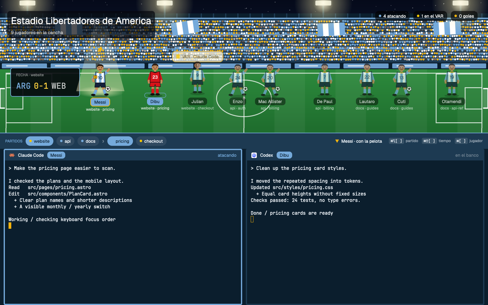
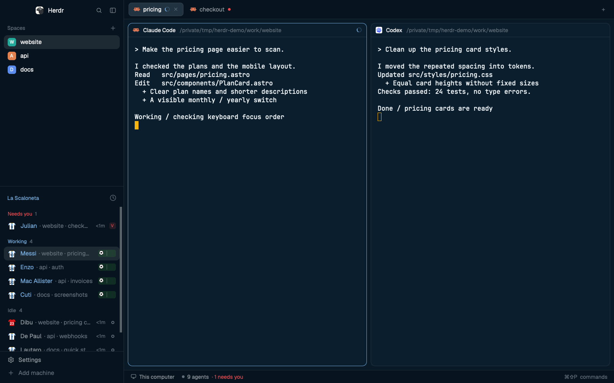
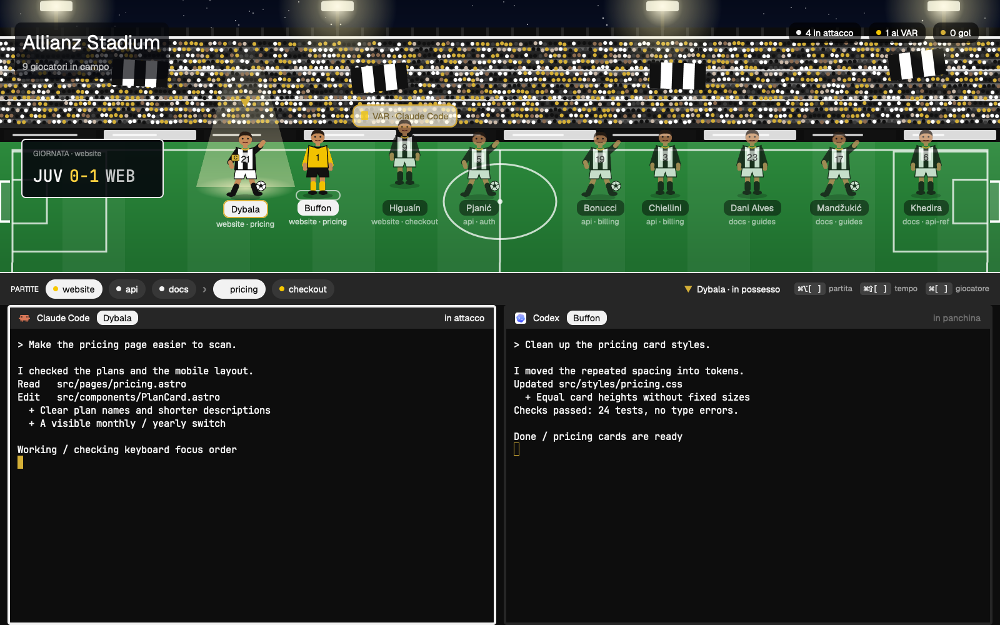
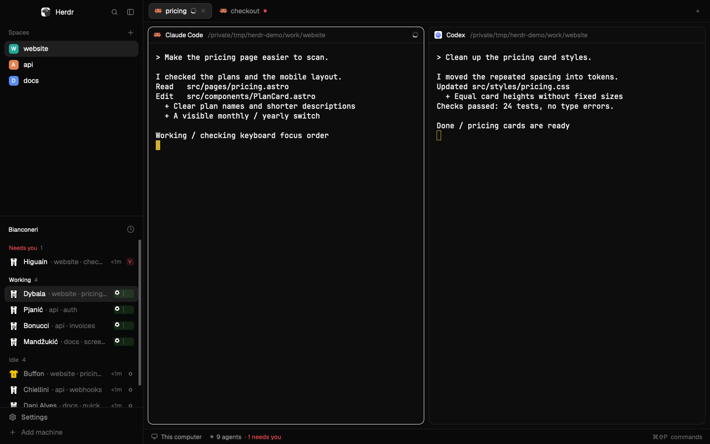
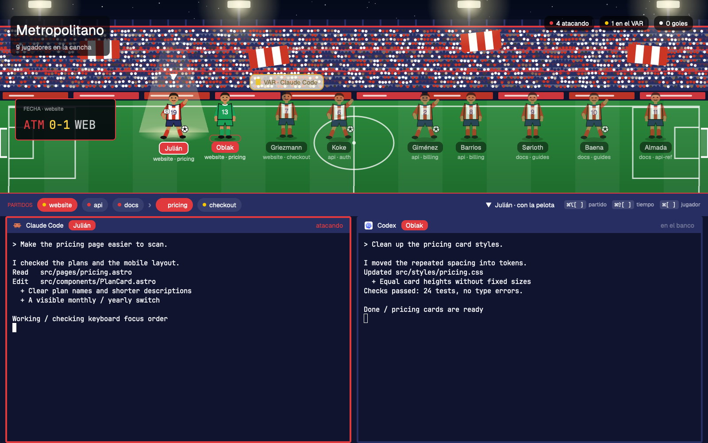
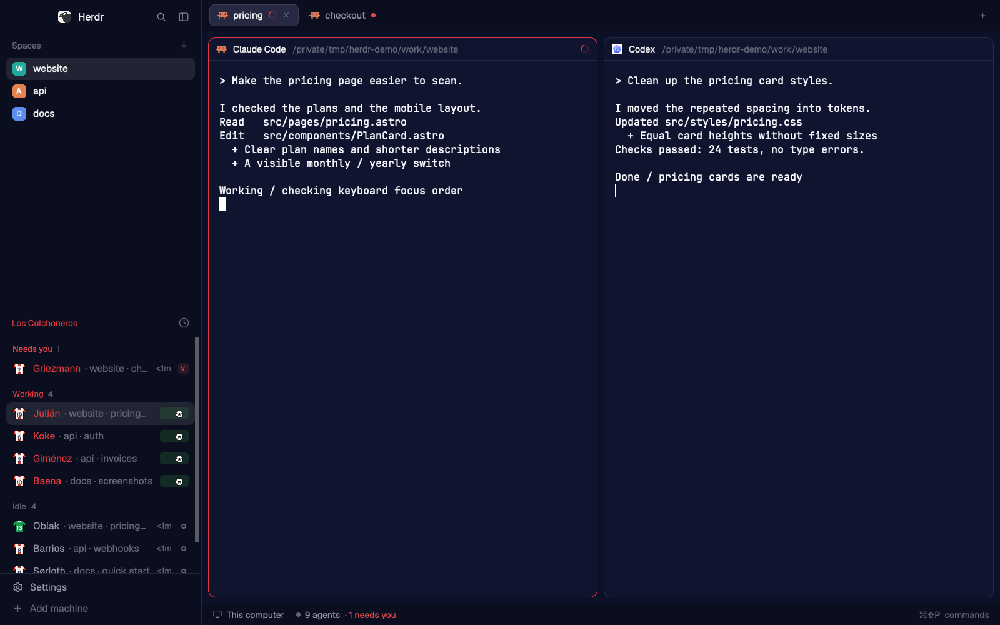
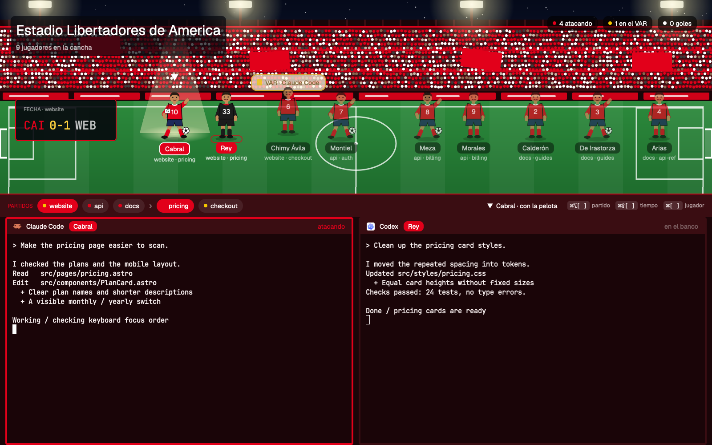
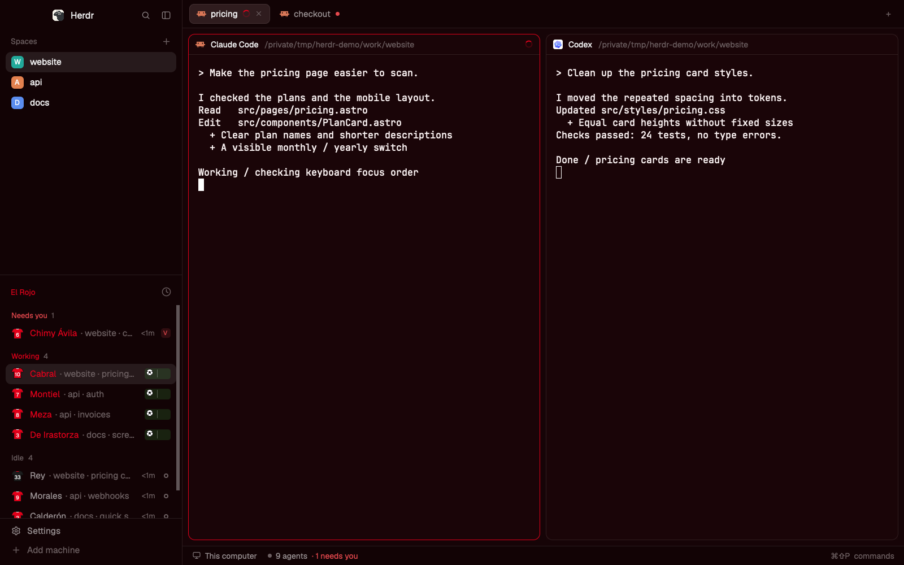
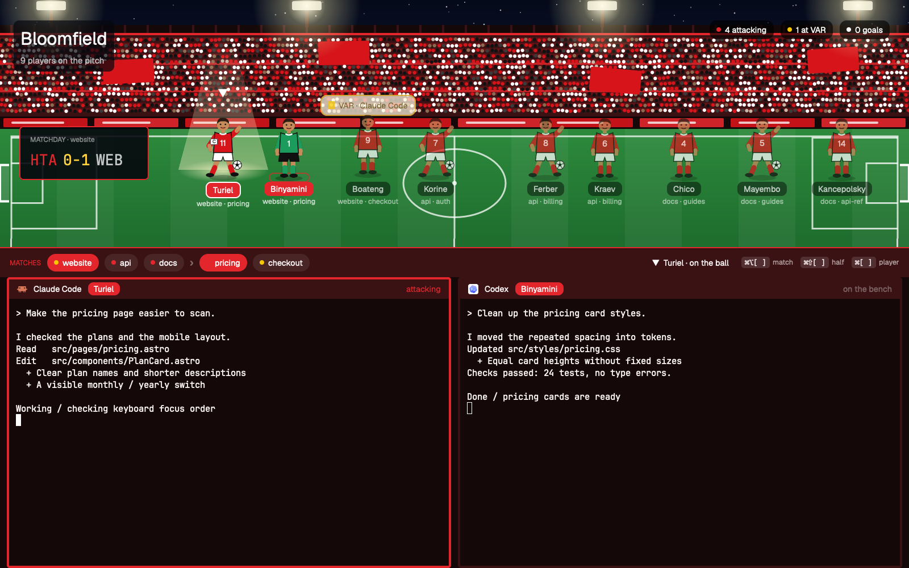
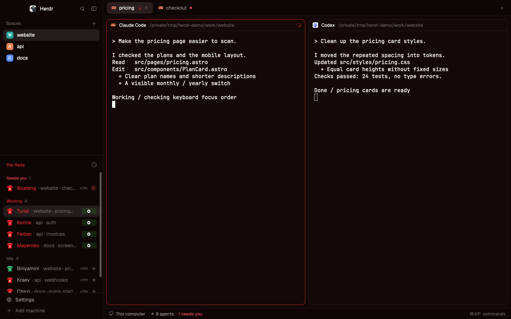

# Football themes for Herdr

Your coding agents as football players, for the [Herdr](https://herdr.dev) desktop app. Five teams, each with two layouts: a **classic** Herdr window in the team's colors, and a **stadium** with the whole squad on the pitch.



Each team folder is laid out like `~/.config/herdr-app`:

```
argentina/
├── RECIPE.md                  what you see, how it behaves, install, limits, squad source
├── preview.png                the stadium layout
├── preview-classic.png        the classic layout
├── layouts/albiceleste.json, albiceleste-Stadium.json (+ their .svg tiles for Settings > Look)
├── themes/albiceleste.json
└── mods/albiceleste-agents/, mods/albiceleste-stadium/
```

| Team | Layouts | Stadium | Classic |
| --- | --- | --- | --- |
| [Argentina](argentina/) | `albiceleste`, `albiceleste-Stadium` |  |  |
| [Juventus](juventus/) | `JUV`, `JUV-Stadium` |  |  |
| [Atletico Madrid](atletico-madrid/) | `ATM`, `ATM-Stadium` |  |  |
| [Independiente](independiente/) | `CAI`, `CAI-Stadium` |  |  |
| [Hapoel Tel Aviv](hapoel-tel-aviv/) | `HTA`, `HTA-Stadium` |  |  |

## What it does

| Status | Stadium | Classic |
| --- | --- | --- |
| working | runs with the ball | jersey jogs, a ball rolls |
| blocked | jumps under a VAR bubble with a yellow card | `VAR` tag |
| done | celebrates, "GOOOL!" | `GOL` / `GOAL` tag |
| idle | stands and waits | ring |

In the stadium, the agent you're looking at stands in a floodlight with the captain's armband. The bar under the pitch lists every space and the shown space's tabs; click one to go there, or click a player. Keys: `⌘⌥[` `⌘⌥]` space, `⌘⇧[` `⌘⇧]` tab, `⌘[` `⌘]` player. Keepers wear their own kit. Words follow the team: Spanish, Italian or English.

## Install

Needs the Herdr app (0.1.15 or later; it creates its app home on first start) and `python3`.

```sh
git clone https://github.com/OrenTheRed/herdr-themes && cd herdr-themes
./install.sh                    # every team; never overwrites anything already there
./install.sh juventus           # one team (the file name in teams/)
./install.sh --update juventus  # replace this repo's files, backing up the old ones first
herdr-app do layout.switch '{"name":"JUV-Stadium"}'
```

The app home is `$HERDR_APP_HOME`, else `~/.config/herdr-app`. Replaced files go to `<app home>/.herdr-themes-backup/<time>/`. You can also copy one team folder's `layouts/`, `themes/` and `mods/` entries by hand, as each RECIPE.md describes. Switch layouts in Settings > Look or with `⌘⇧L`; `ctrl-alt-shift-escape` always brings back Herdr's default screen.

## How it is built

```
teams/<id>.json        colors, kits (outfield + keeper), squad, stadium, language: the one file to edit per team
src/classic/           agents-list mod + layout template (modified from Herdr's built-in agents mod, see NOTICE)
src/stadium/main.js    the stadium mod: pitch, players, scoreboard, navigation bar, terminal headers
build.py               writes each team folder: layouts, themes, mods, generated SVG art, RECIPE.md
install.sh             build, then copy into the app home
tools/demo-scene.sh    the made-up demo scene the screenshots use
```

All art (jerseys, players, ball, spotlight, stadium) is SVG generated from the team file. To add a team, copy a file in `teams/`, change it, and run `./install.sh <new-id>`. Mark a keeper with `"gk"` as the third item of their squad entry.

## About the demo

The screenshots show a made-up scene of nine fake agents in three spaces (website, api, docs), run in a separate, empty Herdr app home and core session: four working, one needs you, two done, two idle. No real work, people or data appear in them. `tools/demo-scene.sh` explains how to run it.

## Squads

| Team | Squad | Source |
| --- | --- | --- |
| Argentina | 2026 World Cup | [Mundo Albiceleste, 2026-05-28](https://mundoalbiceleste.com/2026/05/28/argentina-national-team-shirt-numbers-announced-for-world-cup-lionel-messi-to-wear-10-for-record-time/) |
| Juventus | 2016-17 | [Wikipedia: 2016-17 Juventus FC season](https://en.wikipedia.org/w/index.php?oldid=1383808656) |
| Atletico Madrid | 2025-26 | [Wikipedia: 2025-26 Atlético Madrid season](https://en.wikipedia.org/w/index.php?oldid=1380212022) |
| Independiente | 2026 | [Wikipedia: Club Atlético Independiente](https://en.wikipedia.org/w/index.php?oldid=1384844882), read 2026-11-11 |
| Hapoel Tel Aviv | 2026 | [Wikipedia: Hapoel Tel Aviv F.C.](https://en.wikipedia.org/w/index.php?oldid=1382708626), read 2026-11-11 |

The first player in each list is picked first, the first-choice keeper second. Club keeper kit colors are a style choice, not a specific season's kit.

## License

[Apache License 2.0](LICENSE). Includes code modified from the [Herdr desktop app](https://github.com/herdrdev/herdr-app) (Apache-2.0); see [NOTICE](NOTICE).

Unofficial fan project. Not affiliated with, endorsed by or sponsored by AFA, FIFA, Juventus FC, Club Atlético de Madrid, Club Atlético Independiente or Hapoel Tel Aviv FC. Names identify them only; no crests, logos or official kit artwork are included.
