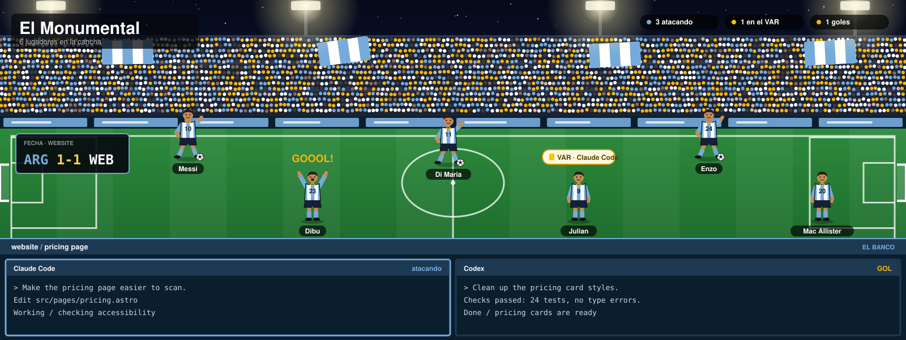
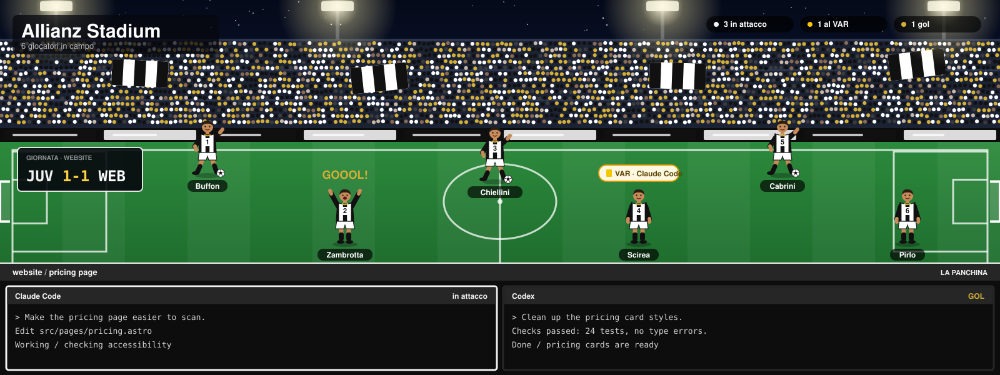
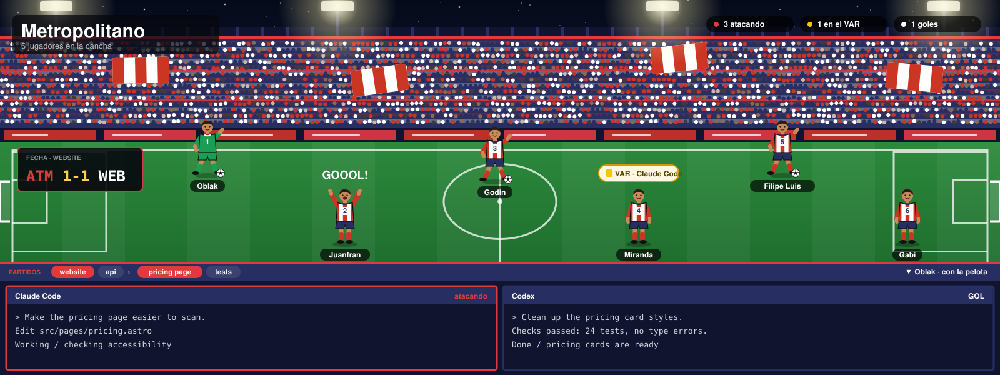
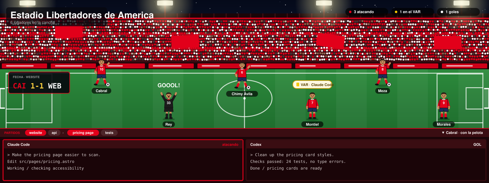
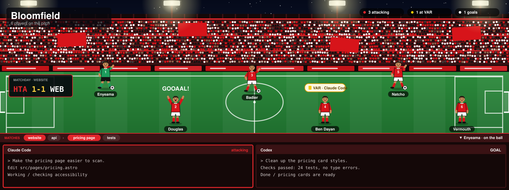

# herdr-themes

Football club themes for the [Herdr](https://herdr.dev) desktop app. Your coding agents become players.

Every team has two looks:

- **Classic**: the normal Herdr window in the team's colors. In the agents list, each agent wears the team jersey with a shirt number and a player's name; keepers wear their own kit. A working agent's jersey jogs, and a ball rolls on a small pitch next to it.
- **Stadium**: a full night stadium on top of the window, with the active tab's terminals on the bench below. Stands, roof, seats, flags and fans are in the team's colors. Inspired by Herdr's [pasture](https://github.com/herdrdev/herdr-layout-examples/tree/main/pasture) example.

| State | Classic | Stadium |
| --- | --- | --- |
| working | jersey jogs, ball rolls | player runs with the ball |
| blocked | `VAR` tag | player jumps under a VAR bubble with a yellow card |
| done | `GOL` / `GOAL` tag | player celebrates, arms up |
| idle | ring | player stands and waits |

In the stadium:

- **The player you're looking at** stands in a floodlight beam with the captain's armband, a bouncing marker and a gold-rimmed name tag. The bar below names them ("Messi · con la pelota"), and each terminal header names its player.
- **Players whose terminals are on the bench** wear a bright name tag; the rest are dimmed.
- **Moving around**: the bar under the pitch lists every space and the shown space's tabs. Click one to go there, or click a player. Keys: `⌘⌥[` `⌘⌥]` space, `⌘⇧[` `⌘⇧]` tab, `⌘[` `⌘]` player.

## Teams

| Team | Layouts | Stadium |
| --- | --- | --- |
| Argentina | `albiceleste`, `albiceleste-Stadium` |  |
| Juventus | `JUV`, `JUV-Stadium` |  |
| Atletico Madrid | `ATM`, `ATM-Stadium` |  |
| Independiente | `CAI`, `CAI-Stadium` |  |
| Hapoel Tel Aviv | `HTA`, `HTA-Stadium` |  |

## Install

Needs the Herdr app (it creates `~/.config/herdr-app` on first start) and `python3`.

```sh
./install.sh                 # every team
./install.sh juventus        # one team (the id in teams/)
```

Then pick a layout in Settings > Look, cycle with `⌘⇧L`, or:

```sh
herdr-app do layout.switch '{"name":"albiceleste-Stadium"}'
```

`ctrl-alt-shift-escape` always brings back Herdr's default screen.

## How it is built

```
teams/<id>.json      colors, kits (outfield + keeper), squad, stadium, language: the only file to edit per team
src/classic/         agents-list mod + layout template (a modified copy of Herdr's built-in agents mod)
src/stadium/         stadium mod: pitch, players, scoreboard, navigation bar, terminal headers
build.py             writes dist/<id>/ (layouts, themes, mods, art) and previews/
install.sh           build, then copy dist/ into ~/.config/herdr-app
```

All art (jerseys, players, ball, spotlight, stadium) is generated SVG from the team file. Add a team by copying a file in `teams/` and running `./install.sh <new-id>`. Mark a keeper with `"gk"` as the third item of their squad entry.

## Squads

- **Argentina**: the 2026 World Cup squad and shirt numbers, from [Mundo Albiceleste (2026-05-28)](https://mundoalbiceleste.com/2026/05/28/argentina-national-team-shirt-numbers-announced-for-world-cup-lionel-messi-to-wear-10-for-record-time/). Keepers (Dibu 23, Musso 1, Rulli 12) wear red.
- **Clubs**: legends, numbered 1 to 15 by lineup position, not their real shirt numbers; written from memory and not checked against a source. Keeper kit colors are a style choice, not a specific season's kit.

Edit `squad` in the team file to change them.

Built for Herdr app 0.1.15.
