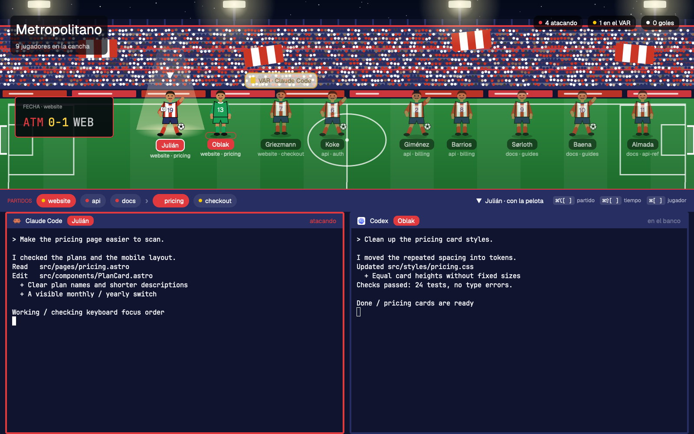
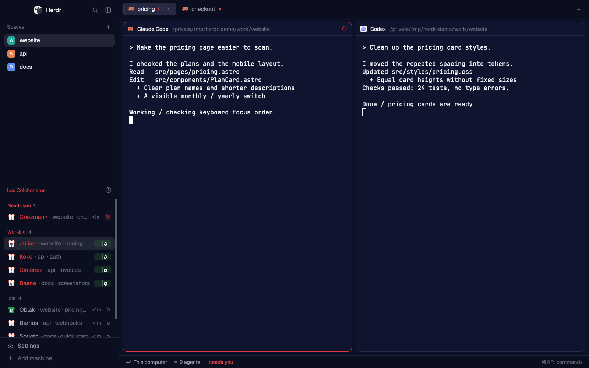

# Atletico Madrid for Herdr

Your coding agents as Atletico Madrid players. Two layouts: **ATM** keeps the normal Herdr
window in Atletico Madrid colors, **ATM-Stadium** puts the whole squad on a pitch.





## What you see

**ATM-Stadium**, top to bottom:

1. **The pitch**: a night stadium at Metropolitano, floodlights, stands, roof and seats in
   Atletico Madrid colors, fans and flags in the kit. Top left the stadium name, a scoreboard
   (ATM goals-VAR against the shown space), top right the counts. One player per agent,
   with its shirt number, name, space and tab.
2. **The bar**: every space, then the shown space's tabs, as chips you click; the player you're
   looking at; the keys.
3. **The bench**: the shown tab's terminals, each header naming its player and status.

**ATM**: Herdr's own window with the agents list titled "Los Colchoneros": each agent wears
the Atletico Madrid jersey with a shirt number and a player's name; keepers wear their own kit.

## How it behaves

| Status | Stadium | Classic |
| --- | --- | --- |
| working | runs left and right with the ball at its feet | jersey jogs, a ball rolls on a small pitch |
| blocked | jumps under a "VAR · program" bubble with a yellow card | `VAR` tag |
| done | celebrates, arms up, "GOOOL!" | `GOL` tag |
| idle | stands, breathing | ring |

- The agent you're looking at stands in a floodlight beam with the captain's armband and a
  bouncing marker. Agents in the shown tab wear a bright name tag; the rest are dimmed.
- Click a player to show its agent, or a chip in the bar to show a space or tab. Keys:
  `⌘⌥[` `⌘⌥]` space, `⌘⇧[` `⌘⇧]` tab, `⌘[` `⌘]` player.
- Each agent keeps its player while it lives; the first agent gets Julián.
  Keepers: Oblak (13), Musso (1).

## Install

Copy into your Herdr app home (`~/.config/herdr-app`, or `$HERDR_APP_HOME`) only names that are free:
`layouts/ATM.json`, `layouts/ATM.svg`, `layouts/ATM-Stadium.json`, `layouts/ATM-Stadium.svg`,
`themes/ATM.json`, `mods/atletico-madrid-agents/`, `mods/atletico-madrid-stadium/`. Or from the repo root:

```sh
./install.sh atletico-madrid
herdr-app check ~/.config/herdr-app/mods/atletico-madrid-stadium
herdr-app do layout.switch '{"name":"ATM-Stadium"}'
```

## What it cannot do yet

- Players stand in up to three rows of up to six; with many agents in a narrow window the last
  ones can pass the right edge.
- On a very short pitch block the stadium name and counts move into the scoreboard.

## Squad

2025-26 season squad and shirt numbers, from Wikipedia '2025-26 Atlético Madrid season' (https://en.wikipedia.org/w/index.php?oldid=1380212022). Edit `squad` in `teams/atletico-madrid.json` and run `./install.sh --update atletico-madrid`.
