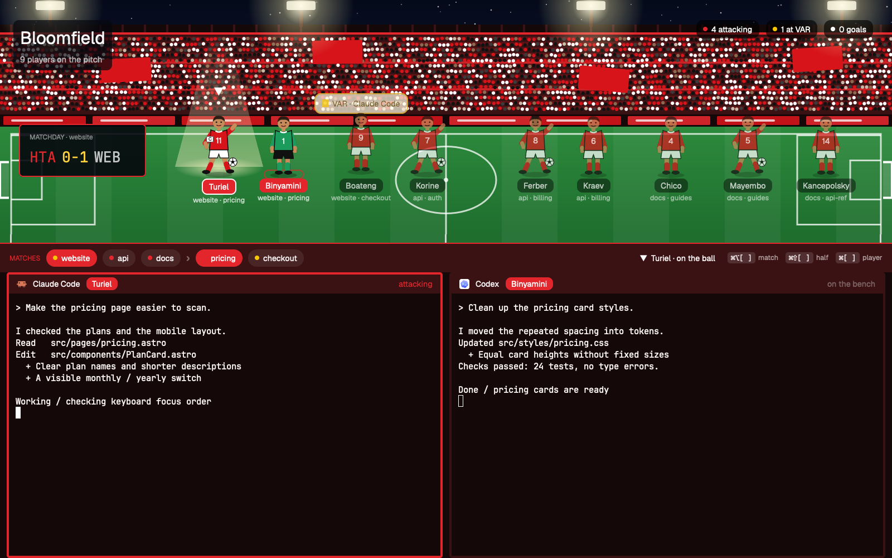
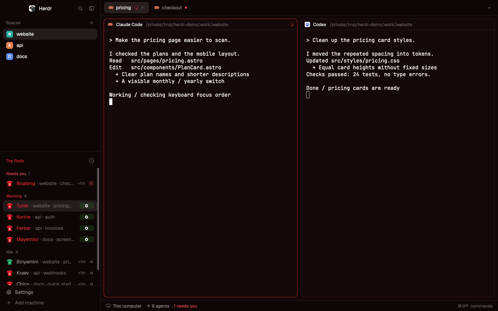

# Hapoel Tel Aviv for Herdr

Your coding agents as Hapoel Tel Aviv players. Two layouts: **HTA** keeps the normal Herdr
window in Hapoel Tel Aviv colors, **HTA-Stadium** puts the whole squad on a pitch.





## What you see

**HTA-Stadium**, top to bottom:

1. **The pitch**: a night stadium at Bloomfield, floodlights, stands, roof and seats in
   Hapoel Tel Aviv colors, fans and flags in the kit. Top left the stadium name, a scoreboard
   (HTA goals-VAR against the shown space), top right the counts. One player per agent,
   with its shirt number, name, space and tab.
2. **The bar**: every space, then the shown space's tabs, as chips you click; the player you're
   looking at; the keys.
3. **The bench**: the shown tab's terminals, each header naming its player and status.

**HTA**: Herdr's own window with the agents list titled "The Reds": each agent wears
the Hapoel Tel Aviv jersey with a shirt number and a player's name; keepers wear their own kit.

## How it behaves

| Status | Stadium | Classic |
| --- | --- | --- |
| working | runs left and right with the ball at its feet | jersey jogs, a ball rolls on a small pitch |
| blocked | jumps under a "VAR · program" bubble with a yellow card | `VAR` tag |
| done | celebrates, arms up, "GOOAAL!" | `GOAL` tag |
| idle | stands, breathing | ring |

- The agent you're looking at stands in a floodlight beam with the captain's armband and a
  bouncing marker. Agents in the shown tab wear a bright name tag; the rest are dimmed.
- Click a player to show its agent, or a chip in the bar to show a space or tab. Keys:
  `⌘⌥[` `⌘⌥]` space, `⌘⇧[` `⌘⇧]` tab, `⌘[` `⌘]` player.
- Each agent keeps its player while it lives; the first agent gets Turiel.
  Keepers: Binyamini (1), Tzur (22), Bazadog (33).

## Install

Copy into your Herdr app home (`~/.config/herdr-app`, or `$HERDR_APP_HOME`) only names that are free:
`layouts/HTA.json`, `layouts/HTA.svg`, `layouts/HTA-Stadium.json`, `layouts/HTA-Stadium.svg`,
`themes/HTA.json`, `mods/hapoel-tel-aviv-agents/`, `mods/hapoel-tel-aviv-stadium/`. Or from the repo root:

```sh
./install.sh hapoel-tel-aviv
herdr-app check ~/.config/herdr-app/mods/hapoel-tel-aviv-stadium
herdr-app do layout.switch '{"name":"HTA-Stadium"}'
```

## What it cannot do yet

- Players stand in up to three rows of up to six; with many agents in a narrow window the last
  ones can pass the right edge.
- On a very short pitch block the stadium name and counts move into the scoreboard.

## Squad

current squad and shirt numbers (read 2026-11-11), from Wikipedia 'Hapoel Tel Aviv F.C.' (https://en.wikipedia.org/w/index.php?oldid=1382708626). Edit `squad` in `teams/hapoel-tel-aviv.json` and run `./install.sh --update hapoel-tel-aviv`.
